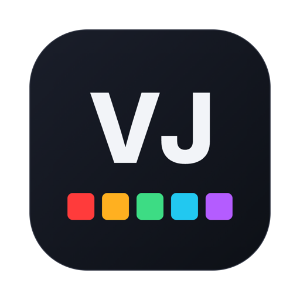
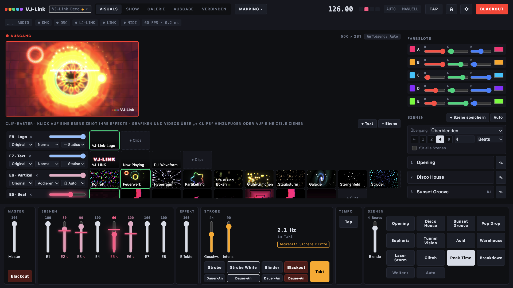
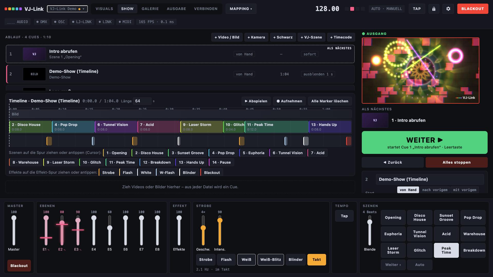
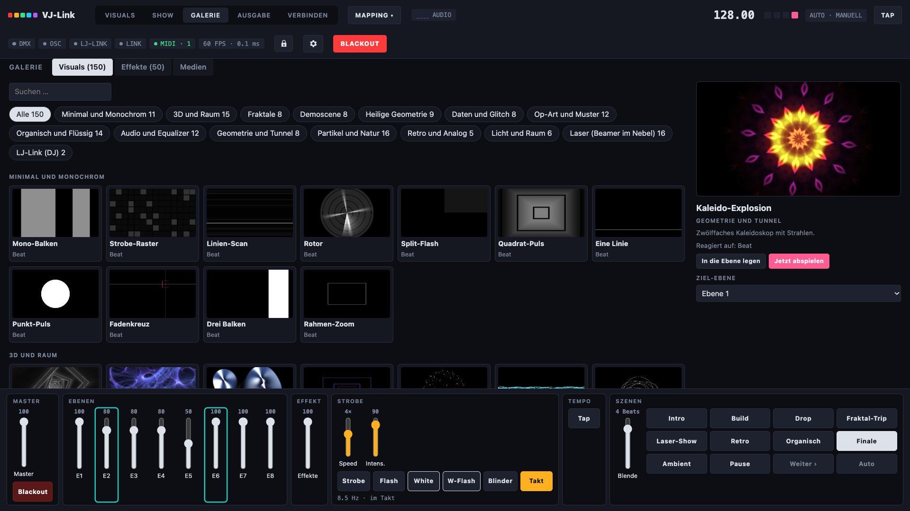
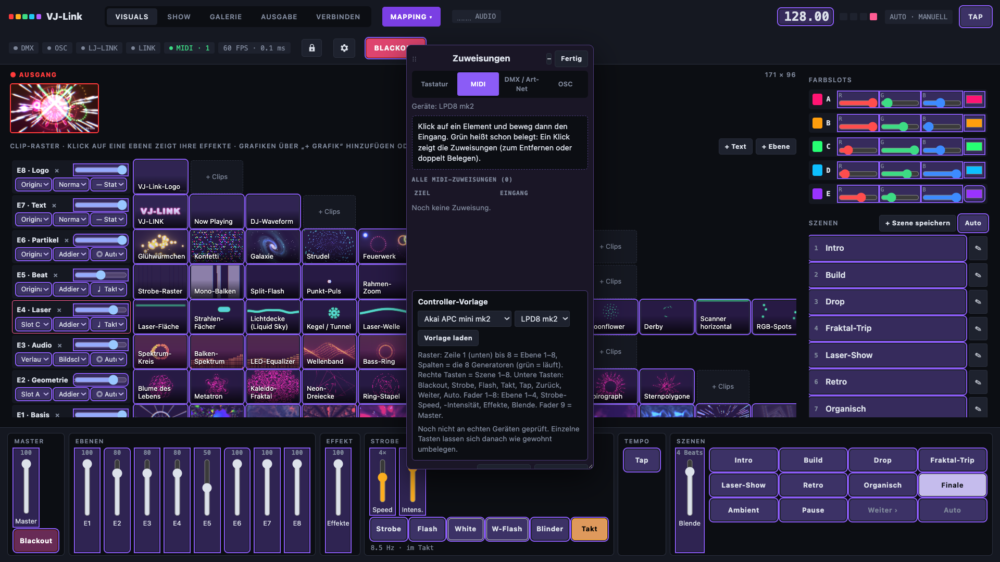
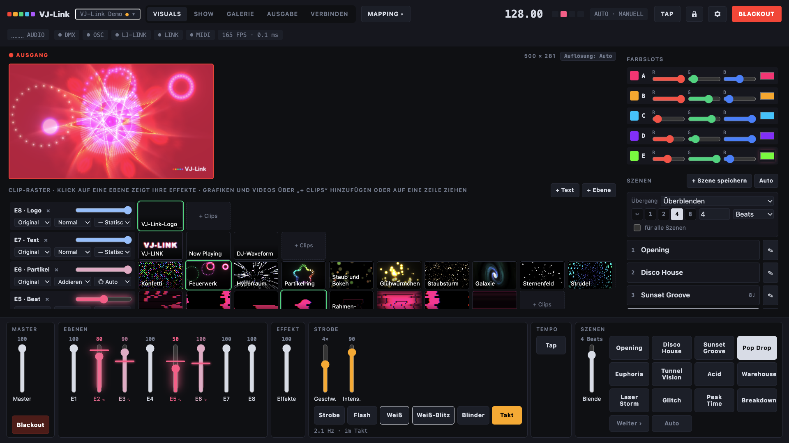
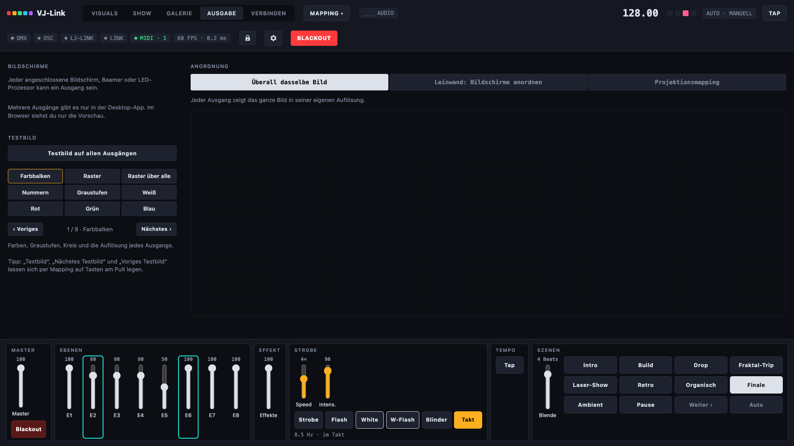
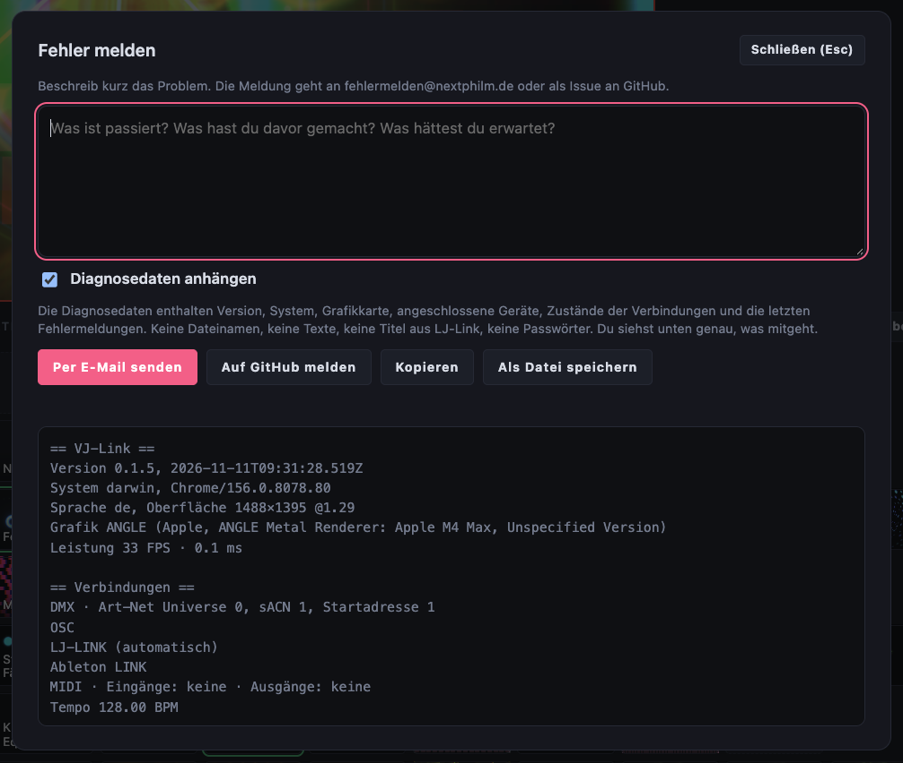
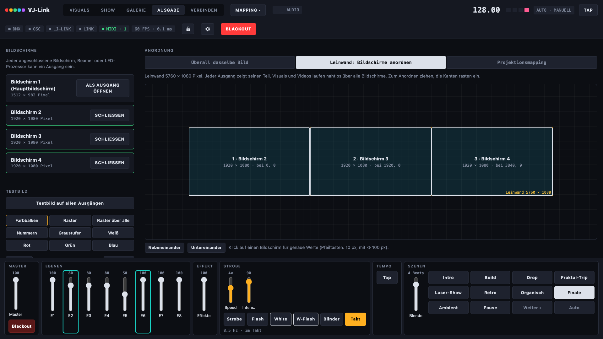
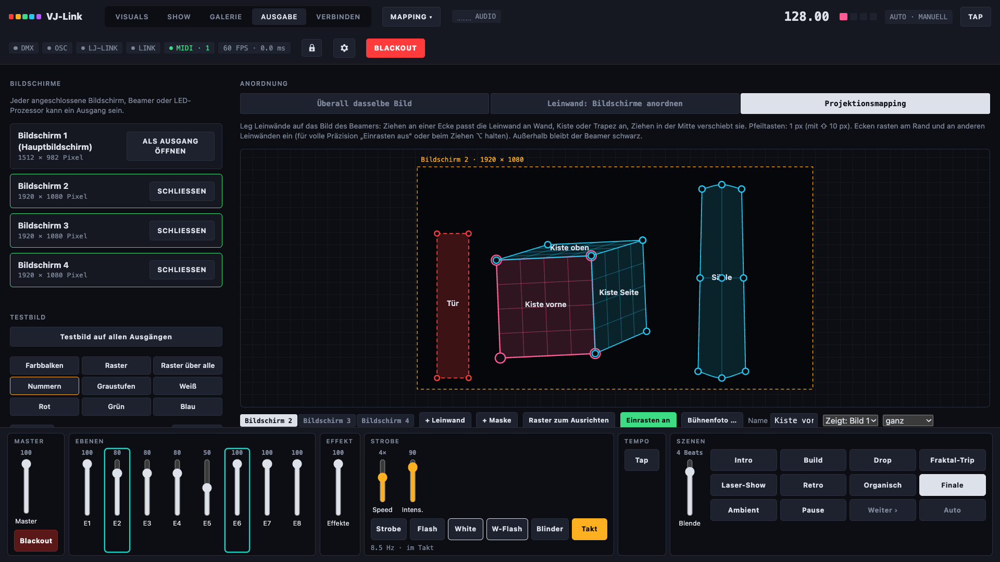

  

<h1 align="center">VJ-Link</h1>

  Live-Visuals, gesteuert von deinem Lichtpult. 
  150 Visuals, 50 Effekte, Szenen und Ausgänge – im Takt der Musik.

  <a href="https://skyplayser.github.io/VJ-LINK/de/">Website</a> &nbsp;·&nbsp;
  <a href="https://github.com/skyplayser/VJ-LINK/releases/latest">Download</a> &nbsp;·&nbsp;
  <a href="#schnellstart">Schnellstart</a> &nbsp;·&nbsp;
  <a href="README.md">English</a> &nbsp;·&nbsp;
  <a href="https://skyplayser.github.io/VJ-LINK/de/wiki.html">Wiki</a> &nbsp;·&nbsp;
  <a href="https://discord.gg/N6DMca4Bjk">Discord</a> &nbsp;·&nbsp;
  <a href="https://github.com/skyplayser/VJ-LInk-dev">Quellcode</a>

  
  
  

Auf den meisten Veranstaltungen hat niemand Zeit für einen zweiten Rechner voller VJ-Software. VJ-Link ist für den Lichtjockey
gebaut: Das Lichtpult schickt Szene, Farben, Helligkeit, Strobe und Blackout, und die Visuals folgen von selbst dem Tempo der
Musik. Es spielt auf beliebig vielen Bildschirmen, Beamern und LED-Wänden, mappt auf Wände und Kisten und läuft als
getimte Show mit Videos und Cues.

Alles läuft lokal. Kein Konto, keine Cloud, keine Telemetrie. Nach außen geht nur die Update-Prüfung (GitHub) und eine
Fehlermeldung, wenn du eine schickst.

> [!WARNING]
> **Das ist die erste öffentliche Alpha (0.0.1).** Auf unseren Rechnern läuft sie gut, aber große Teile haben noch keine echte
> Bühnentechnik gesehen. Verlass dich bitte noch nicht bei einer wichtigen Show darauf, und sag uns, was dir auffällt:
> **Hilfe → Fehler melden** im Programm.

## Was du bekommst

- **150 Visuals in 16 Kategorien:** Minimal und Monochrom, 3D und Raum, Fraktale, Demoscene, Heilige Geometrie, Daten und
  Glitch, Op-Art, Organisch und Flüssig, Audio und Equalizer, Partikel, Retro und Synthwave, Geometrie und Tunnel, Licht und
  Raum sowie 16 Laser-Looks für einen Beamer im Nebel. Alle eigens für VJ-Link geschrieben, alle reagieren auf Beat oder Audio.
- **50 Effekte** in einem Stapel mit bis zu sechs je Ebene: Feedback, Datamosh, Slit-Scan, VHS, Bloom, Kaleidoskop, Halbton,
  LCD, Pixel-Sort, Luma-Key, Farb-Strobe, Beat-Flip und viele mehr.
- **Bis zu acht Ebenen** mit Mischmodi, Deckkraft, Position, Größe und Drehung. Jede Ebene wählt ihren Antrieb: Audio, falls
  vorhanden, sonst Takt; nur Takt; nur Audio; oder statisch.
- **Farben vom Pult:** fünf Farbslots (A–E) über DMX, MIDI oder OSC. Eine Ebene nimmt einen Slot, mehrere, einen Verlauf oder
  einen Regenbogen.
- **Szenen** mit eigenem Übergang (Schnitt, Beats oder Sekunden, Überblenden oder über Schwarz) und automatischer Abfolge: weiter
  nach Takten, Sekunden oder beim Phrasenwechsel aus [LJ-Link](https://github.com/skyplayser/LJ-Link).
- **Das Pult führt:** Art-Net und sACN mit festem Pult-Profil (Kanalliste als CSV), dazu freies Mapping für Tastatur, MIDI, DMX
  und OSC wie in Daslight: Element anklicken, Fader bewegen. Vorlagen für Akai APC mini und Korg nanoKONTROL2, LED-Rückmeldung,
  Modulation mit LFOs oder Audio-Bändern.
- **Tempo von überall:** LJ-Link (wird automatisch gefunden, auch auf anderen Rechnern), Ableton Link (über Carabiner), OSC,
  MIDI-Clock, Audio-Eingang oder Tap.
- **Ausgänge:** ein Fenster pro Bildschirm in jeder Auflösung, überall dasselbe Bild oder eine Leinwand über alle, ein
  Fenster-Ausgang für OBS, NDI- und Syphon-Werkzeuge, Testbilder und **Projektionsmapping** mit Eckpunkten, Raster-Verzerrung
  (3×3, 5×5) und Masken.
- **SHOW:** ein Ablauf aus Video-, Bild-, Kamera-, Schwarz-, Szenen- und Timecode-Cues mit WEITER auf der Leertaste, dazu eine
  Timeline, auf der Szenen und Effekte (Strobe, Flash, Blinder, Blackout) wie im Schnittprogramm liegen. Timecode rein und raus
  über Art-Net und MIDI.
- **Kameras:** Webcam, Capture-Karte oder OBS Virtual Camera als Clip. Looks: Silhouette, Umriss, Dot-Matrix, ASCII, Raster,
  Wärmebild, Duoton und Masken, die die Visuals nur in der Person zeigen oder die Person ausschneiden. Die **Personen-Erkennung**
  läuft lokal (MediaPipe), ganz ohne Greenscreen.
- **Medien und Text:** Logos und Bilder mit automatischem Freistellen, Videos mit einem Loop im Takt und Text-Clips mit Schrift,
  Leuchten, Kontur und Kasten.
- **Aus LJ-Link:** Tempo, Beat-Phase, Phrasen und Trackwechsel, eine *Now-Playing*-Bauchbinde und die DJ-Waveform als Clips.
- **Leicht zu starten:** ein Startbildschirm, eine **Demo-Show**, die von selbst läuft, eine Galerie mit Live-Vorschau für jedes
  Visual und jeden Effekt, ein Sperrmodus für die Show, Projektdateien (`.vjlink`) mit ihren Medien, Updates von GitHub und
  **Deutsch und Englisch**.

<table>
  <tr>
    <td width="50%"> <b>SHOW.</b> Ablauf mit WEITER und einer Timeline für Szenen und Effekte.</td>
    <td width="50%"> <b>Galerie.</b> 150 Visuals und 50 Effekte mit Live-Vorschau.</td>
  </tr>
  <tr>
    <td> <b>Mapping.</b> Element anklicken, Fader am Controller bewegen.</td>
    <td> <b>Szene „Drop“</b> aus der Demo: Tunnel, Dreiecke, Laser und Strobe-Raster.</td>
  </tr>
  <tr>
    <td> <b>Ausgänge.</b> Bildschirme, Leinwand, Projektionsmapping und Testbilder.</td>
    <td> <b>Fehler melden</b> mit Diagnosedaten, die du vor dem Senden siehst.</td>
  </tr>
</table>

## Mehrere Bildschirme und Projektionsmapping – kinderleicht

Kein Pixel-Rechnen, keine Konfigurationsdateien. Unter **AUSGABE** öffnest du jeden Beamer und jede LED-Wand mit einem Klick,
wählst **Leinwand** und ziehst die Bildschirme dorthin, wo sie hängen: Visuals und Videos laufen nahtlos über alle. Beim
**Projektionsmapping** legst du Leinwände auf das Beamerbild und ziehst ihre Ecken auf die Kanten von Wand, Kiste oder Säule –
live auf dem Beamer. Runde Flächen biegst du mit einem Raster 3×3 oder 5×5, Masken schwärzen Türen und Personen.

<table>
  <tr>
    <td width="50%"> <b>Leinwand.</b> Bildschirme an ihren Platz ziehen, die Kanten rasten ein.</td>
    <td width="50%"> <b>Projektionsmapping.</b> Eine Kiste, eine Säule mit Raster-Verzerrung und eine Tür-Maske.</td>
  </tr>
</table>

## Installieren

Lade den Installer für deinen Rechner aus der [neuesten Version](https://github.com/skyplayser/VJ-LINK/releases/latest).

| System | Datei |
|---|---|
| macOS, Apple-Chip (M1 und neuer) | `VJ-Link-macos-arm64.dmg` |
| macOS, Intel | `VJ-Link-macos-intel.dmg` |
| Windows 10 / 11, 64 Bit | `VJ-Link-windows.exe` |

Die Installer sind noch nicht signiert. Deshalb warnen beide Systeme einmal beim ersten Start:

- **macOS** („VJ-Link“ nicht geöffnet): App in *Programme* ziehen und einmal starten, auf *Fertig* klicken. *Systemeinstellungen
  → Datenschutz & Sicherheit* öffnen, nach unten scrollen, bei VJ-Link auf **Dennoch öffnen** klicken, mit Passwort bestätigen,
  dann *Öffnen*. Kamera, Mikrofon und lokales Netzwerk erlauben, wenn macOS fragt und du sie brauchst. Im Terminal geht auch:
  `xattr -dr com.apple.quarantine "/Applications/VJ-Link.app"`.
- **Windows** („Der Computer wurde durch Windows geschützt“): auf **Weitere Informationen**, dann auf **Trotzdem ausführen**
  klicken. Fragt die Firewall, *Private Netzwerke* anhaken und zulassen – sonst erreichen Art-Net, sACN, OSC und LJ-Link
  VJ-Link nicht.

VJ-Link braucht eine Grafikkarte mit WebGL 2. Die hat fast jeder Rechner der letzten zehn Jahre.

## Schnellstart

1. VJ-Link starten und im Startbildschirm auf **Demo öffnen** klicken. Die zehn Szenen laufen von selbst.
2. **AUSGABE** öffnen, den Beamer oder die LED-Wand wählen und als Ausgang öffnen.
3. Unter **VERBINDEN** prüfen, ob das Pult ankommt: Art-Net- oder sACN-Universe und Startadresse einstellen. Die Kanalliste als
   CSV speichern und VJ-Link wie ein Gerät patchen.
4. Oder **MAPPING → MIDI** anklicken, einen Fader auf dem Bildschirm anklicken und einen am Controller bewegen.
5. Läuft LJ-Link im selben Netz? Dann findet VJ-Link es von selbst und folgt dem Tempo des DJs.

Das Programm startet in der Sprache deines Systems; im Startbildschirm schaltest du zwischen Deutsch und Englisch um. Das
[Wiki](https://skyplayser.github.io/VJ-LINK/de/wiki.html) geht jeden Bildschirm durch.

## Lichtpult

VJ-Link nimmt Art-Net oder sACN auf einem Universe an. Das feste Profil *Standard* hat 91 Kanäle: Master, Strobe, Szene, Blende,
Tempo-Faktor, Effekt-Intensität, Auto und Blackout; die fünf Farbslots mit Dimmer und RGB; für die Ebenen 1–4 Deckkraft,
Clip-Bank, Clip, Farbquelle, Geschwindigkeit, drei Effekte, Strobe und Mischmodus; Strobe-Intensität und -Modus; und auf den
Kanälen 71–91 die Bilder des Projektionsmappings. Alles andere (Ebenen 5–8, jeder weitere Regler) lässt sich frei zuweisen. Es wirken nur Kanäle, die
sich ändern – Maus, MIDI und Pult arbeiten also nebeneinander.

| Pult | Weg | Stand |
|---|---|---|
| grandMA2, grandMA3, onPC | Art-Net oder sACN, die CSV-Kanalliste als Gerät patchen | gebaut, noch nicht am echten Pult probiert |
| Daslight, andere DMX-Software | Art-Net oder sACN | gebaut, noch nicht probiert |
| Jedes Pult und jeder Controller mit MIDI | MIDI-Mapping (Noten und CCs) | in der App getestet |
| Jedes Programm mit OSC | Port 8000, `/vjlink/…`, jedes Element als `/vjlink/ctl/<id>` | in der App getestet |
| Timecode | Art-Net- und MIDI-Timecode, rein und raus, 24/25/29,97 DF/30 fps | gebaut, noch nicht mit einem Pult probiert |

## Kompatibilität

| Teil | Stand |
|---|---|
| macOS, Apple-Chip | getestet |
| macOS, Intel | gebaut, nicht getestet |
| Windows 10 / 11 | gebaut, nicht getestet |
| [LJ-Link](https://github.com/skyplayser/LJ-Link) 1.7.7 | getestet: automatisch gefunden, Tempo, Now Playing |
| Akai LPD8 mk2 | als MIDI-Eingang erkannt |
| Akai APC mini mk2, APC mini, Korg nanoKONTROL2 | Vorlagen nach Handbuch, nicht an den Geräten getestet |
| Webcam (UVC), OBS Virtual Camera | getestet, Personen-Erkennung mit einer Person getestet |
| Ableton Link | über [Carabiner](https://github.com/Deep-Symmetry/carabiner) auf Port 17000, noch nicht probiert |
| Beamer im Nebel (Laser-Looks) | noch nicht probiert |

Sag uns bitte, was du getestet hast: **Hilfe → Fehler melden** oder auf [Discord](https://discord.gg/N6DMca4Bjk).

## Roadmap

| Ziel | Stand |
|---|---|
| Visuals, Effekte, Ebenen, Szenen, SHOW, Timeline | fertig (Alpha) |
| Art-Net, sACN, MIDI, OSC, Tastatur-Mapping | fertig, Tests an echten Pulten fehlen |
| Projektionsmapping, Leinwand, Fenster-Ausgang | fertig (Alpha) |
| Personen-Erkennung für Kamera-Looks | fertig (Alpha) |
| Natives Syphon und Spout, NDI | geplant (bis dahin: Fenster-Ausgang und Bildschirmaufnahme) |
| Pult-Profile als GDTF und grandMA2-XML | geplant |
| Fernbedienung im Browser | geplant |
| Tempo-Erkennung aus Audio | geplant |
| Signierte Installer | geplant |

## Gut zu wissen

- **Ableton Link** braucht Carabiner als eigenes Programm (das Link-SDK steht unter GPL, deshalb ist es nicht in VJ-Link).
- **Videos:** MP4 mit H.264 und WebM laufen überall. Videos kommen in die Bibliothek von VJ-Link und werden beim Speichern in
  einem Ordner „*Name* Medien“ neben der Projektdatei abgelegt.
- **Kamera-Looks** mit Personen-Erkennung klappen am besten mit einer oder wenigen Personen im Bild. Kleine Personen weit weg auf
  einer großen Bühne werden schlechter erkannt.
- **Projektionsmapping** braucht einen Ausgang je Beamer. Ein Fenster-Ausgang kann einen ersetzen, etwa zum Abgreifen in OBS.
- **Updates** brauchen Internet. Ohne läuft alles wie gewohnt, die Prüfung meldet nur, dass GitHub nicht erreichbar ist.

## Probleme?

Nutze **Fehler melden** im Programm (Hilfe-Menü, Einstellungen oder Startbildschirm): Beschreib, was passiert, und lass
*Diagnosedaten anhängen* angehakt. Die Diagnosedaten enthalten Version, System, Grafikkarte, angeschlossene Geräte, den Zustand
der Verbindungen und die letzten Fehlermeldungen – keine Dateinamen, keine Texte, keine Titel, keine Passwörter – und du siehst
sie vor dem Senden. Schick sie per E-Mail (dein Mailprogramm öffnet eine Mail an fehlermelden@nextphilm.de) oder als
GitHub-Issue.

## Probier auch: LJ-Link

**[LJ-Link](https://github.com/skyplayser/LJ-Link)** zeigt dem Lichtjockey, was der DJ spielt: jedes Deck, jede Waveform, jeden
Cue und das BPM von Pioneer- und Denon-Geräten, und schickt das Tempo an grandMA, Daslight und mehr. Zusammen mit VJ-Link folgen
die Visuals dem Beat des DJs, wechseln beim Phrasenwechsel die Szene und zeigen, was gerade läuft. Kostenlos für macOS und
Windows.

 

## Danksagung und Hinweise

Die Personen-Erkennung nutzt [MediaPipe](https://github.com/google-ai-edge/mediapipe) (Apache-2.0). Gebaut mit Electron. Ableton
Link läuft über [Carabiner](https://github.com/Deep-Symmetry/carabiner) von Deep Symmetry, das als eigenes Programm läuft.

VJ-Link ist kein offizielles Produkt von MA Lighting, Daslight, Akai, Korg, Ableton, OBS oder Google. Alle Produktnamen gehören
ihren Inhabern und dienen nur der Beschreibung der Kompatibilität.

## Lizenz

© 2026 Philipp Spruck / NEXTPHILM. VJ-Link steht unter der [Eclipse Public License 2.0](LICENSE) und wird ohne jede
Gewährleistung bereitgestellt. Der Quellcode liegt unter [skyplayser/VJ-LInk-dev](https://github.com/skyplayser/VJ-LInk-dev); dieses Repository enthält die
Veröffentlichungen, die Website und die Dokumentation. Die Lizenzen der verwendeten Bausteine stehen in
[THIRD_PARTY.md](https://github.com/skyplayser/VJ-LInk-dev/blob/grundgeruest/THIRD_PARTY.md).

 

  Idee SKYPLAYSER/NEXTPHILM 
  Prompted with ❤️ made by Claude

