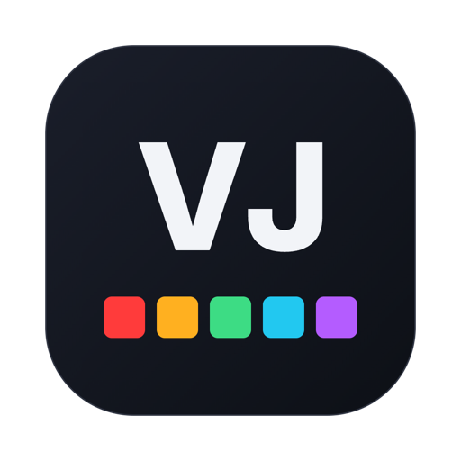
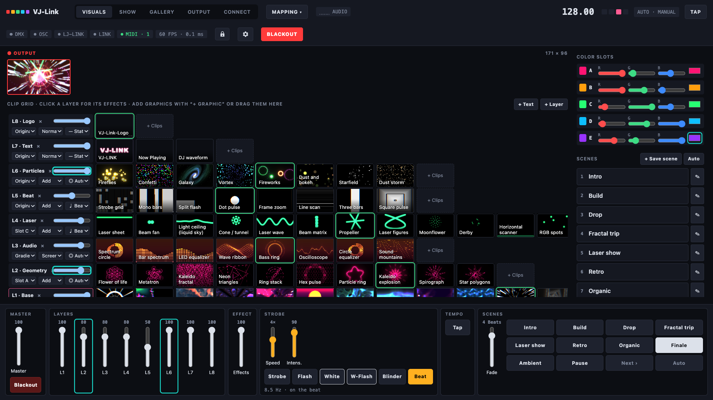
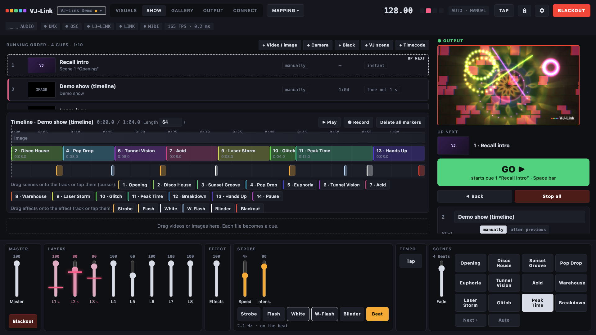
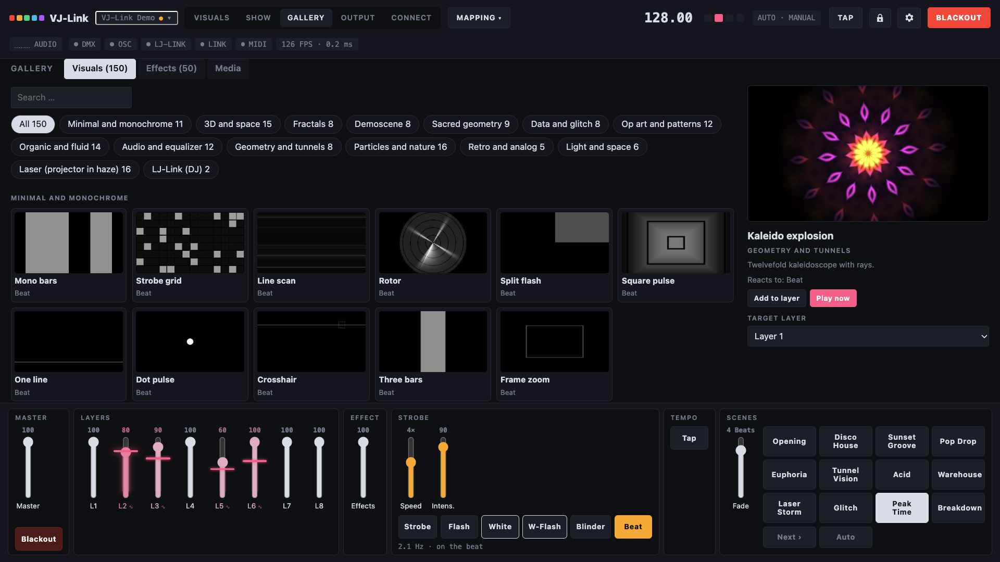
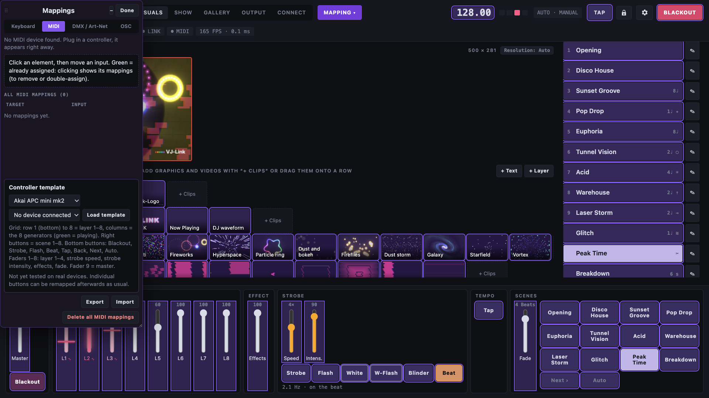
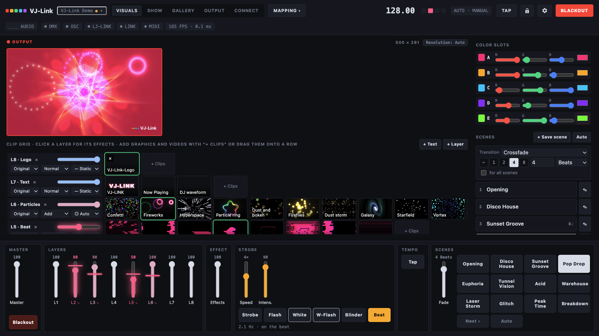
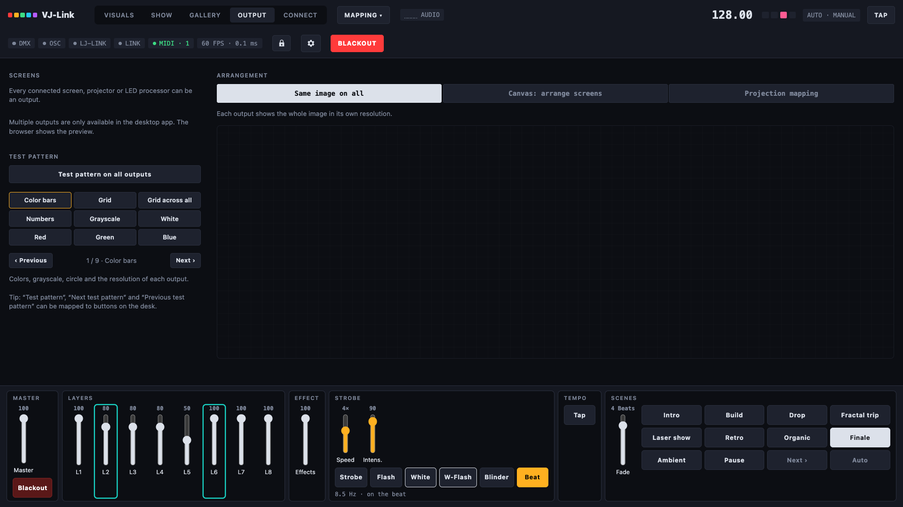
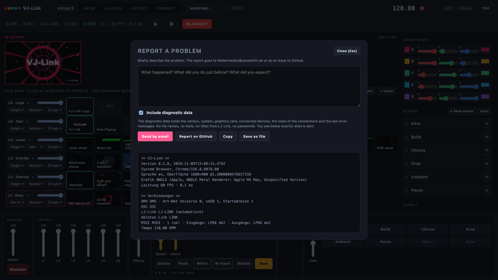
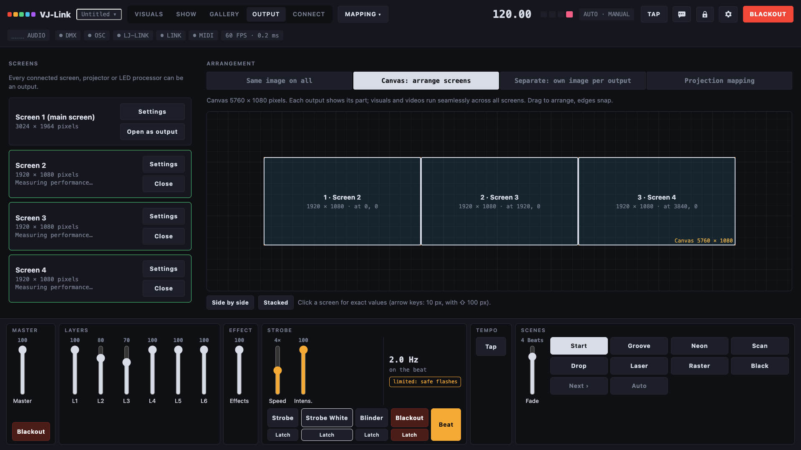
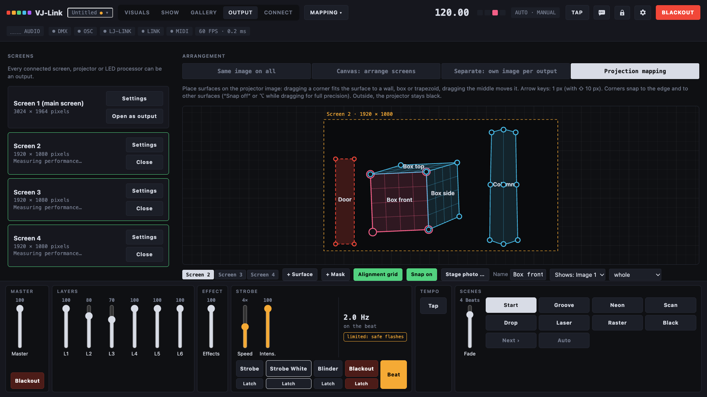

  

<h1 align="center">VJ-Link</h1>

  Live visuals, run by your lighting desk. 
  162 visuals, 50 effects, scenes and outputs, in time with the music.

  <a href="https://skyplayser.github.io/VJ-LINK/">Website</a> &nbsp;·&nbsp;
  <a href="https://skyplayser.github.io/Link-Suite/">Download</a> &nbsp;·&nbsp;
  <a href="#quick-start">Quick start</a> &nbsp;·&nbsp;
  <a href="README.de.md">Deutsch</a> &nbsp;·&nbsp;
  <a href="https://skyplayser.github.io/VJ-LINK/wiki.html">Wiki</a> &nbsp;·&nbsp;
  <a href="https://discord.gg/N6DMca4Bjk">Discord</a> &nbsp;·&nbsp;
  <a href="https://github.com/skyplayser/VJ-LINK/tree/main/source">Source code</a>

  
  
  
  

At most events nobody has time for a second computer full of VJ software. VJ-Link is built for the lighting jockey: the light
desk sends the scene, the colors, the brightness, the strobe and the blackout, and the visuals follow the tempo of the music on
their own. It plays on any number of screens, projectors and LED walls, maps onto walls and boxes, and runs as a timed show with
videos and cues.

It runs locally. There is no account, no cloud and no telemetry. The only connections outside your network are the update check
(VJ-Link asks GitHub for the newest version at start and then at most once an hour; you can switch it off in *Settings → Update*)
and a problem report, when you send one.

> [!WARNING]
> **This is the beta 0.1.18.** After a full test day (bugs, workflows, interface and a security test) it is a lot more robust
> than the first alpha, but large parts have still not met real stage hardware. Please try it before an important show, and
> tell us what you find: **Help → Report a problem** in the program.

## What you get

- **162 visuals in 16 categories:** minimal and monochrome, 3D and space, fractals, demoscene, sacred geometry, data and glitch,
  op art, organic and fluid, audio and equalizer, particles, retro and synthwave, geometry and tunnels, light and space, clock and time (clock, countdown, stopwatch, date, BPM, timecode), and 16
  laser looks for a projector in haze. Written for VJ-Link; all of them react to the beat or the audio. A few small building blocks
  follow published, MIT-licensed snippets – see *Shader credits* in
  [THIRD_PARTY.md](https://github.com/skyplayser/VJ-LINK/blob/main/source/THIRD_PARTY.md).
- **50 effects** in a stack of up to six per layer: feedback, datamosh, slit-scan, VHS, bloom, kaleidoscope, halftone, LCD,
  pixel sort, luma key, color strobe, beat flip and many more.
- **Up to eight layers** with blend modes, opacity, position, size and rotation. Each layer chooses its drive: audio when there is
  some, otherwise the beat; only the beat; only the audio; or static.
- **Colors from the desk:** five color slots (A–E) set by DMX, MIDI or OSC. A layer takes one slot, several, a gradient or a
  rainbow.
- **Scenes** with their own transition (cut, beats or seconds, fade or through black) and an automatic order: next after bars,
  seconds or a phrase change from [LJ-Link](https://github.com/skyplayser/LJ-Link).
- **The light desk leads:** Art-Net and sACN with a fixed desk profile (channel list as CSV), plus free mapping for keyboard,
  MIDI, DMX and OSC like in Daslight: click an element, move the fader. Templates for Akai APC mini and Korg nanoKONTROL2, LED
  feedback, modulation with LFOs or audio bands.
- **Tempo from everywhere:** LJ-Link (found automatically, also on other computers), Ableton Link (through Carabiner), OSC,
  MIDI clock or tap.
- **Outputs:** one window per screen in any resolution, the same picture on all of them or one canvas across all, a window output
  that OBS can capture, **NDI®** output, an image area per output in pixels (LED controllers), output profiles per venue, test patterns, and **projection mapping** with corner pin, grid warp (3×3, 5×5) and masks.
- **SHOW:** a running order of video, image, camera, black, scene and timecode cues with GO on the space bar, and a timeline
  where scenes and effects (strobe, flash, blinder, blackout) are laid out like in an editing program. Timecode in and out over
  Art-Net and MIDI.
- **Cameras:** webcam, capture card or OBS Virtual Camera as a clip. Looks: silhouette, outline, dot matrix, ASCII, halftone,
  thermal, duotone and masks that show the visuals only inside the person or cut the person out. **Person detection** runs
  locally (MediaPipe), no green screen needed.
- **Media and text:** logos and images with automatic background removal, videos with a loop locked to the beat, and text clips
  with font, glow, outline and box.
- **From LJ-Link:** tempo, beat phase, phrases and track changes, a *Now Playing* lower third and the DJ waveform as clips.
- **New in 0.1.12:** the **particle object**: 3D bodies made of thousands of sticks that explode on the beat or the bass and snap back, rotation per axis, five built-in bodies and your own **OBJ/STL** models ([wiki](https://skyplayser.github.io/VJ-LINK/wiki-particles.html), needs a strong graphics card); the arrangement **Separate**, where every output shows its own image, e.g. two identical screens with different visuals ([wiki](https://skyplayser.github.io/VJ-LINK/wiki-outputs.html#each-output-its-own-picture)); **modulation with a range** from–to ([wiki](https://skyplayser.github.io/VJ-LINK/wiki-modulation.html#range)); and *New project* **with starter setup or empty**.
- **New in 0.1.18:** **MOV files of every kind**, also **transparent** ones: ProRes 4444, Animation and PNG-MOV are converted on import into WebM with alpha, so logos lie over the visuals, in layers and in the SHOW ([wiki](https://skyplayser.github.io/VJ-LINK/wiki-media.html#transparent-videos)). **Projection mapping**: masks as **circle, portal**, rectangle, rounded, triangle, hexagon or star, with four corners for perspective – show only inside to light just a portal or a circle ([wiki](https://skyplayser.github.io/VJ-LINK/wiki-mapping-projection.html)).
- **New in 0.1.17:** **timecode like in QLab**: put a *+ Timecode* cue *with previous* below a video, and the timecode starts with the video and stops at its end; or give any cue a *Timecode from*. VJ-Link is the **timecode master** and sends over Art-Net, MIDI (MTC) and now also **LTC over an audio output** (output, channel, gain) ([wiki](https://skyplayser.github.io/VJ-LINK/wiki-timecode.html)).
- **New in 0.1.16:** the **phone remote** with four tabs: **Start** (live picture, blackout, master, scene, GO, tempo, test pattern, keep the screen awake), **Scenes** (all scenes, fade, transition), **Layers** (mixer with the opacity of every layer, clips, blend mode, change text clips, clock clips, colours) and **Show** (GO, back, stop all, running order); it can sit on the home screen like an app ([wiki](https://skyplayser.github.io/VJ-LINK/wiki-phone-remote.html)). **Fixed:** in the gallery the target layer shows the layer names, and the previews of the particle objects show the right body.
- **New in 0.1.15:** a **preview window** for a second screen with the layer preview and the live picture ([wiki](https://skyplayser.github.io/VJ-LINK/wiki-outputs.html#preview-window)); **clock and time clips**: clock, countdown to a time or for a duration, stopwatch, date, BPM and timecode ([wiki](https://skyplayser.github.io/VJ-LINK/wiki-media.html#clock-and-time)); a SHOW cue can **start at a time of day** ([wiki](https://skyplayser.github.io/VJ-LINK/wiki-show.html#start-at-a-time)); **Export show package** with the name of the show, and **.vjlink files open with a double click** ([wiki](https://skyplayser.github.io/VJ-LINK/wiki-projects.html#show-package)); particle objects as a **real 3D body** with the effects Particles, **Drift**, Melt, Jelly, Dissolve, Twist and Shatter (separate parts fly on their own) ([wiki](https://skyplayser.github.io/VJ-LINK/wiki-particles.html#effects)); up to **20 layers**; with LJ-Link **bar 1 and every 2/4 bars land on the downbeat and the phrase**.
- **Fixed in 0.1.15:** the NDI output sends again on Windows with display scaling (e.g. 125 %); before, receivers were connected but got 0 frames/s.
- **New in 0.1.14:** **Settings → NDI** shows the version of the NDI runtime, lets you choose the **network adapter** NDI sends over and shows every NDI output with receivers and data rate ([wiki](https://skyplayser.github.io/VJ-LINK/wiki-ndi.html#ndi-settings)); a **network adapter for Art-Net and sACN**, so another console on the Wi-Fi does not interfere ([wiki](https://skyplayser.github.io/VJ-LINK/wiki-connections.html#network-adapter)).
- **Fixed in 0.1.14:** dots and edges of the particle object cover fully, also over other layers, and bright highlights no longer clip to white. Since 0.1.13 the list in *+ Clips* stays where it is when you pick a clip.
- **New in 0.1.10:** **NDI® output** (up to four sources with own name, free size and frame rate; [wiki](https://skyplayser.github.io/VJ-LINK/wiki-ndi.html)),
  **image area, device and output profiles** per output, e.g. an LED wall that uses only 280 × 112 pixels of a 1280 × 1024 controller signal,
  strobe and blinder per device ([wiki](https://skyplayser.github.io/VJ-LINK/wiki-output-area.html)), a **phone remote** in the local Wi-Fi with QR pairing
  ([wiki](https://skyplayser.github.io/VJ-LINK/wiki-phone-remote.html)), a **show package for USB** and moving clips in the grid. *Community function! Thanks to Fabi!*
- **Start animation and Link-Suite (new in 0.1.9):** the short animation every program of the [Link-Suite](https://skyplayser.github.io/Link-Suite/) shares, at most 2.5 s, any key skips it. If the launcher is missing, the start screen shows a small card *Get Link-Suite*. [Wiki](https://skyplayser.github.io/VJ-LINK/wiki-projects.html#start-animation)
- **Suite chat (Alpha, new in 0.1.8):** one chat room with LJ Link and [LJL Link](https://github.com/skyplayser/LJL-Link) (the DJs) in the same network, no server needed. An
  **EMERGENCY** button shows a pop-up with a yellow blinking border at everyone else at once. Only in the control window,
  never on the outputs; switch it off in *Settings → Suite chat*. [Protocol](https://github.com/skyplayser/LJ-Link/blob/main/docs/suite-chat.md).
  Tested on one Mac with LJ Link, LJL Link and VJ-Link; not yet between two computers, not on Windows, not in a club.
  EMERGENCY is a heads-up pop-up for the team, not an alarm or safety system. It is an alpha, can fail or arrive late, and anyone in the same network can trigger it. It does not replace announcements, radios or the event's safety plan.
- **Easy to start:** a start screen, a **demo show** that plays by itself, a gallery to browse and preview every visual and
  effect, a lock mode for the show, project files (`.vjlink`) with their media, updates from GitHub, and **English and German**.

<table>
  <tr>
    <td width="50%"> <b>SHOW.</b> Running order with GO and a timeline for scenes and effects.</td>
    <td width="50%"> <b>Gallery.</b> Browse 162 visuals and 50 effects with a live preview.</td>
  </tr>
  <tr>
    <td> <b>Mapping.</b> Click an element, move a fader on the controller.</td>
    <td> <b>Scene “Drop”</b> from the demo: tunnel, triangles, lasers and a strobe grid.</td>
  </tr>
  <tr>
    <td> <b>Outputs.</b> Screens, canvas, projection mapping and test patterns.</td>
    <td> <b>Report a problem</b> with diagnostic data you can check before sending.</td>
  </tr>
</table>

## Several screens and projection mapping – child's play

No pixel maths and no config files. Under **OUTPUT** you open each projector or LED wall with one click, choose **Canvas** and
drag the screens to where they hang: visuals and videos run seamlessly across all of them. For **projection mapping** you lay
canvases onto the projector picture and drag their corners onto the edges of a wall, a box or a column – live on the projector.
Round surfaces bend with a 3×3 or 5×5 grid, masks black out doors and people.

<table>
  <tr>
    <td width="50%"> <b>Canvas.</b> Drag the screens into place, the edges snap.</td>
    <td width="50%"> <b>Projection mapping.</b> A box, a column with grid warp and a door mask.</td>
  </tr>
</table>

## Install

> **New: install and update through the [Link-Suite launcher](https://skyplayser.github.io/Link-Suite/).** Download the launcher ([macOS Apple Silicon](https://github.com/skyplayser/Link-Suite/releases/latest/download/Link-Suite-macos-arm64.dmg) · [macOS Intel](https://github.com/skyplayser/Link-Suite/releases/latest/download/Link-Suite-macos-intel.dmg) · [Windows](https://github.com/skyplayser/Link-Suite/releases/latest/download/Link-Suite-windows.exe)), open it and click *Install* next to VJ-Link. The launcher downloads VJ-Link straight from this repository's releases, checks the file and keeps VJ-Link and every other program of the Link-Suite up to date. The single installers of VJ-Link stay in this repository's releases.

Download the Link-Suite launcher for your computer and install VJ-Link from it.

| System | File |
|---|---|
| macOS, Apple Silicon (M1 and newer) | [`Link-Suite-macos-arm64.dmg`](https://github.com/skyplayser/Link-Suite/releases/latest/download/Link-Suite-macos-arm64.dmg) |
| macOS, Intel | [`Link-Suite-macos-intel.dmg`](https://github.com/skyplayser/Link-Suite/releases/latest/download/Link-Suite-macos-intel.dmg) |
| Windows 10 / 11, 64 bit | [`Link-Suite-windows.exe`](https://github.com/skyplayser/Link-Suite/releases/latest/download/Link-Suite-windows.exe) |

The launcher is not signed yet, so both systems warn once on its first start:

- **macOS** (“Link-Suite” Not Opened): drag Link-Suite to *Applications* and start it once, click *Done*. Open *System Settings →
  Privacy & Security*, scroll down, click **Open Anyway** next to Link-Suite and confirm with your password, then *Open*. Allow the
  camera, the microphone and the local network when asked and you need them. Terminal alternative:
  `xattr -dr com.apple.quarantine "/Applications/Link-Suite.app"`. This switches off macOS’s download check for this app, so only
  use it for a copy you downloaded from this GitHub page or the official website.
- **Windows** (“Windows protected your PC”): click **More info**, then **Run anyway**. When the firewall asks, tick *Private
  networks* and allow access, otherwise Art-Net, sACN, OSC and LJ-Link cannot reach VJ-Link.

VJ-Link needs a graphics card with WebGL 2, which almost every computer from the last ten years has.

## Quick start

1. Start VJ-Link and click **Open demo** on the start screen. The 14 scenes play by themselves.
2. Open **OUTPUT**, pick the projector or LED wall and open it as an output.
3. Under **CONNECT** check that your desk arrives: set the Art-Net or sACN universe and the start address. Save the channel list
   as CSV and patch VJ-Link like a fixture.
4. Or click **MAPPING → MIDI**, click a fader on the screen and move one on your controller.
5. Running LJ-Link on the same network? VJ-Link finds it by itself and follows the DJ’s tempo.

The program starts in the language of your system; the start screen switches between English and German. The
[wiki](https://skyplayser.github.io/VJ-LINK/wiki.html) walks through every screen.

## Light desk

VJ-Link takes Art-Net or sACN on one universe. The fixed profile *Standard* has 91 channels: master, strobe, scene, transition,
tempo factor, effect intensity, auto and blackout; the five color slots with dimmer and RGB; for layers 1–4 opacity, clip bank
(always 1 for now), clip (visual 1–150 from the catalog), color source, speed, three effects, strobe and blend mode; strobe intensity and mode; and on channels 71–91 the pictures of
the projection mapping. Everything else (layers 5–8, every other control) can be mapped freely. Only channels that change take
effect, so the mouse, MIDI and the desk can work side by side. Your own logos, videos and text clips go on a layer through
free DMX mapping (MAPPING → DMX).

| Desk | How | State |
|---|---|---|
| grandMA2, grandMA3, onPC | Art-Net or sACN, patch the CSV channel list as a fixture | built, not yet tried on a real desk |
| Daslight, other DMX software | Art-Net or sACN | built, not yet tried |
| Any desk or controller with MIDI | MIDI mapping (notes and CCs) | tested in the app |
| Any program with OSC | port 8000, `/vjlink/…`, every control as `/vjlink/ctl/<id>` | tested in the app |
| Timecode | Art-Net and MIDI timecode, in and out, 24/25/29.97 DF/30 fps | built, not yet tried with a desk |

## Compatibility

| Part | State |
|---|---|
| macOS, Apple Silicon | tested |
| macOS, Intel | built, not tested |
| Windows 10 / 11 | built, not tested |
| [LJ-Link](https://github.com/skyplayser/LJ-Link) 1.7.7 | tested: found automatically, tempo, Now Playing |
| Akai LPD8 mk2 | recognized as MIDI input |
| Akai APC mini mk2, APC mini, Korg nanoKONTROL2 | templates from the manuals, not tested on the devices |
| Webcam (UVC), OBS Virtual Camera | tested, person detection tested with one person |
| Ableton Link | through [Carabiner](https://github.com/Deep-Symmetry/carabiner) on port 17000, not yet tried |
| Projector in haze (laser looks) | not yet tried |

Please tell us what you tested: **Help → Report a problem**, or on [Discord](https://discord.gg/N6DMca4Bjk).

## Roadmap

| Target | State |
|---|---|
| Visuals, effects, layers, scenes, SHOW, timeline | done (beta) |
| Art-Net, sACN, MIDI, OSC, keyboard mapping | done, needs tests on real desks |
| Projection mapping, canvas, window output | done (beta) |
| Person detection for camera looks | done (beta) |
| NDI® output, image area per output, output profiles | done (beta) |
| Native Syphon and Spout | planned (until then: window output and screen capture) |
| Desk profiles as GDTF and grandMA2 XML | planned |
| Phone remote in the browser | done (beta) |
| Tempo detection from audio | planned |
| Signed installers | planned |

## Good to know

- **Ableton Link** needs Carabiner as a separate program (the Link SDK is GPL, so VJ-Link does not contain it).
- **Videos:** MP4 with H.264 and WebM play everywhere. Videos are copied into VJ-Link’s library and saved next to the project file
  in a folder “*name* Medien”.
- **Camera looks** with person detection work best with one or a few people in the picture. Small people far away on a big stage
  are found less reliably.
- **Projection mapping** needs one output per projector. A window output can stand in for one, for example to capture it in OBS.
- **Updates** need the internet. Without it everything works as before, the check just says it could not reach GitHub. Before
  installing, VJ-Link compares the download with the SHA-256 checksum GitHub publishes for it and stops if they differ.
- **Network:** Art-Net, sACN, OSC and the LJ-Link input have no login – that is the industry standard. Keep the show network apart
  from guest Wi-Fi and allow VJ-Link in the firewall only for the private show network.
- **Suite chat:** it has no login and no encryption and is on by default. Anyone in the same network – with a suite program or
  any network tool – can read, write and raise EMERGENCY pop-ups in the control window (at most 3 per program in 60 seconds, at
  most 20 open; nothing ever appears on the outputs). Switch it off in *Settings → Suite chat*; then VJ-Link neither sends nor
  reads chat messages. Networks that block multicast (guest Wi-Fi with client isolation) have no chat. Chat texts are kept only
  in memory, never in a file or problem report, but other programs in the room keep your messages and pass the last 20 on to
  newcomers; name and position are kept in `chat.json`. Details in the
  [privacy policy](https://skyplayser.github.io/VJ-LINK/datenschutz.html). EMERGENCY is a heads-up pop-up for the team, not an alarm or safety system. It is an alpha, can fail or arrive late, and anyone in the same network can trigger it. It does not replace announcements, radios or the event's safety plan.
- **Showing titles and covers in public:** if you put track titles, artists or cover art on screens the audience can see (for
  example with the *Now Playing* clip), you may need permission from the rights holders or the venue. LJ-Link’s privacy mode
  hides titles and covers.

## Live safety

Fast flashes, strobe and strong colour changes can trigger seizures in people with photosensitive epilepsy. Keep the flash rate
low (at most three flashes per second), announce strobe effects where the venue requires it and follow the venue’s rules. Do not
aim bright projector beams through haze at the audience at eye level. Software can fail: keep a fallback ready for the show.

VJ-Link shows this notice before the first output and limits strobe, strobe white, layer strobe, colour strobe and beat invert to
three flashes per second (*Safe flashes*, on by default, *Settings → Safety*). Next to the strobe faders you always see whether it is
on and when it slows the strobe down.

## Problems?

Use **Report a problem** in the program (Help menu, settings or the start screen): describe what happens and leave *Include
diagnostic data* ticked. The diagnostic data holds the version, system, graphics card, connected devices, the state of the
connections and the last error messages – no file names, no texts, no titles, no passwords – and you see it before sending. Send
it by email (your mail program opens a mail to fehlermelden@nextphilm.de) or as a GitHub issue.

## Try also: LJ-Link

**[LJ-Link](https://github.com/skyplayser/LJ-Link)** shows the lighting jockey what the DJ plays: every deck, waveform, cue and
the BPM from Pioneer and Denon gear, and sends the tempo to grandMA, Daslight and more. Together with VJ-Link the visuals follow
the DJ’s beat, change scene on the phrase and show what is playing. Free for macOS and Windows.

 

## Credits and notices

Person detection uses [MediaPipe](https://github.com/google-ai-edge/mediapipe) (Apache-2.0). Built with Electron. Ableton Link
works through [Carabiner](https://github.com/Deep-Symmetry/carabiner) by Deep Symmetry, which runs as its own program. Logo
lettering: [Inter](https://github.com/rsms/inter) (SIL Open Font License). The program ships all license texts in
`THIRD_PARTY_LICENSES.txt` (*Help → Licenses and notices*).

Art-Net™ Designed by and Copyright Artistic Licence Holdings Ltd

VJ-Link is an independent project and not an official product of, or endorsed by, any of the manufacturers named. All product
names and trademarks belong to their respective owners and are used only to describe compatibility. Ableton and Link are
trademarks of Ableton AG. NDI® is a registered trademark of Vizrt NDI AB; VJ-Link is not a product of NDI and ships no NDI files
(the NDI runtime is installed by the user, see [NDI output](https://skyplayser.github.io/VJ-LINK/wiki-ndi.html)).

## License

© 2026 Philipp Spruck / NEXTPHILM. VJ-Link is distributed under the [Eclipse Public License 2.0](LICENSE), without any
warranty. The source code of every official version is in [source/](source/) in this repository, next to the releases,
the website and the documentation. The licenses of the bundled libraries are in [source/THIRD_PARTY.md](source/THIRD_PARTY.md).

 

  Idea SKYPLAYSER/NEXTPHILM 
  Prompted with ❤️ made by Claude 
  <a href="https://skyplayser.github.io/VJ-LINK/impressum.html">Legal notice (Impressum)</a> ·
  <a href="https://skyplayser.github.io/VJ-LINK/datenschutz.html">Privacy</a>

