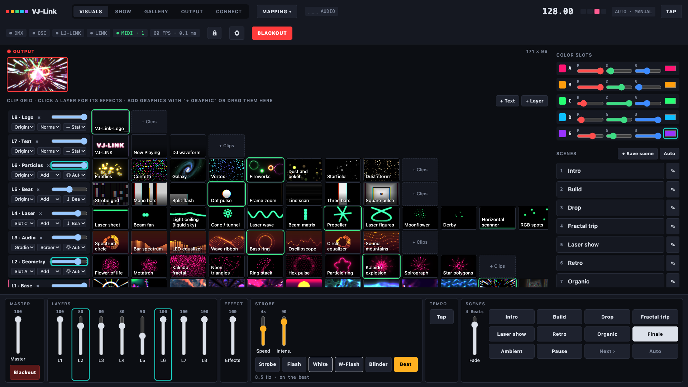
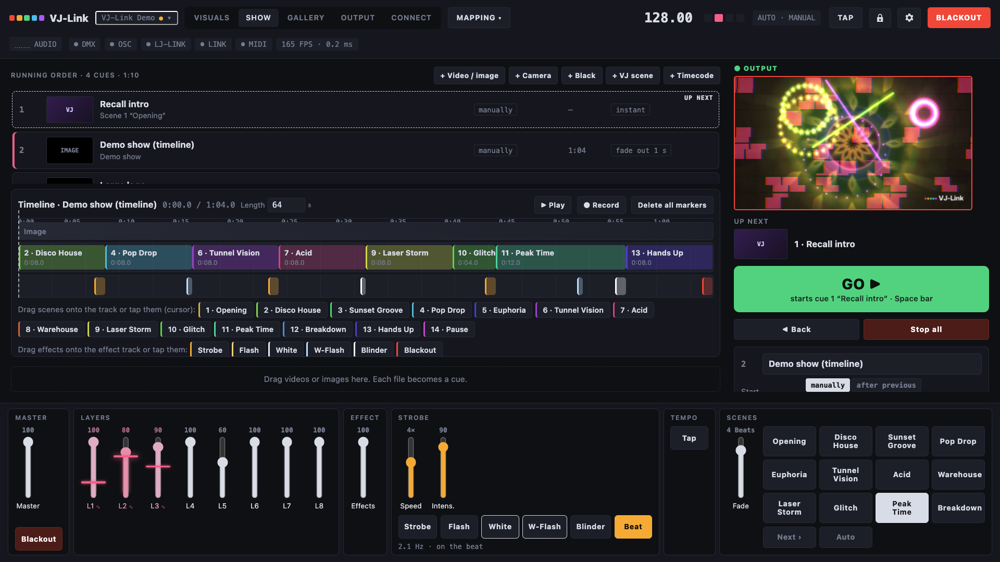
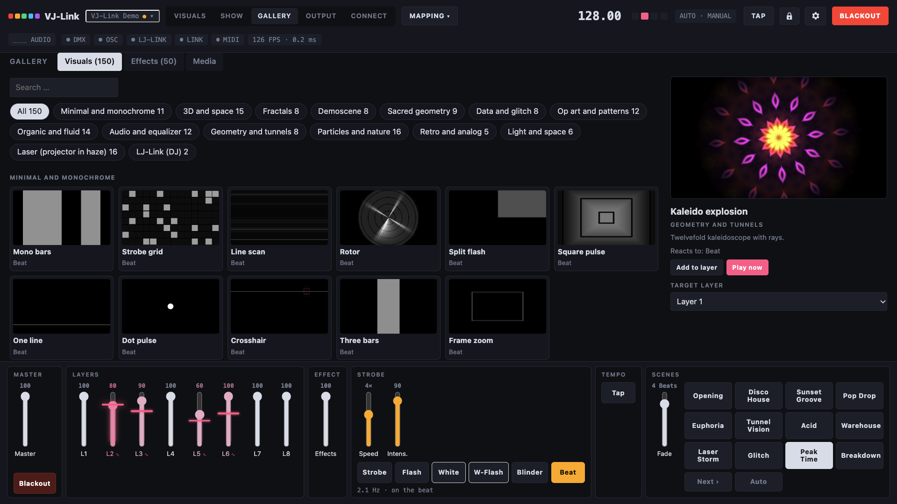
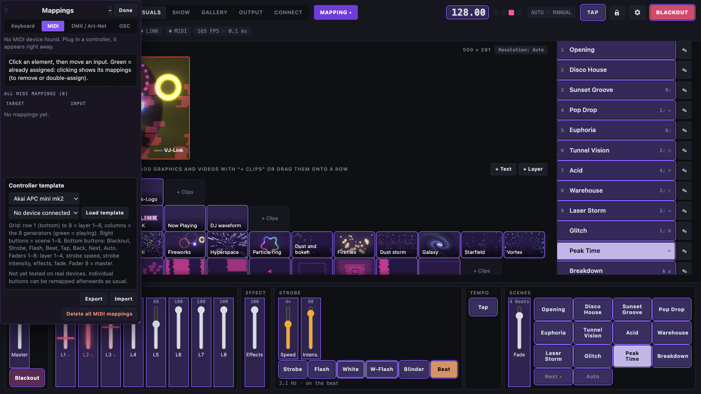
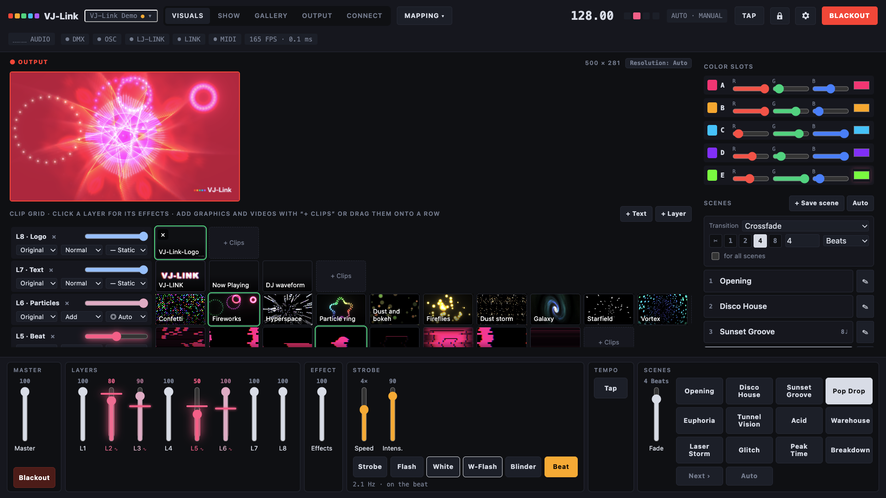
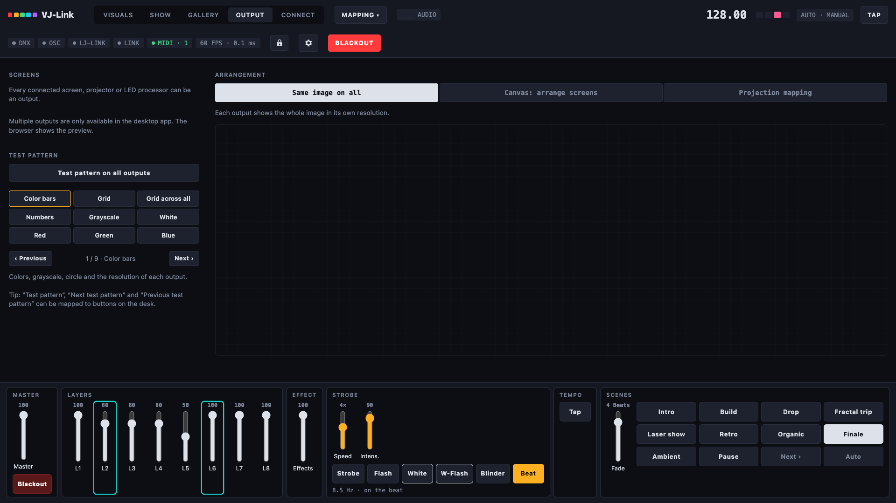
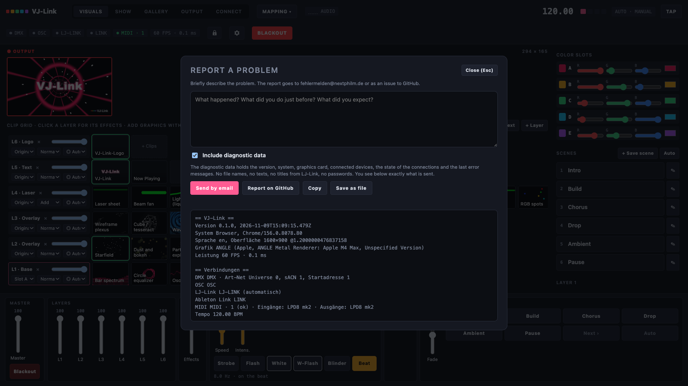
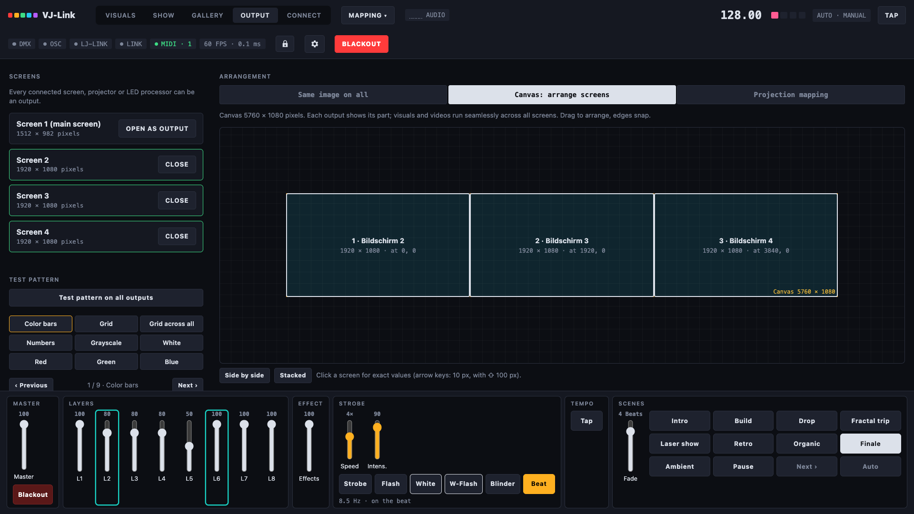
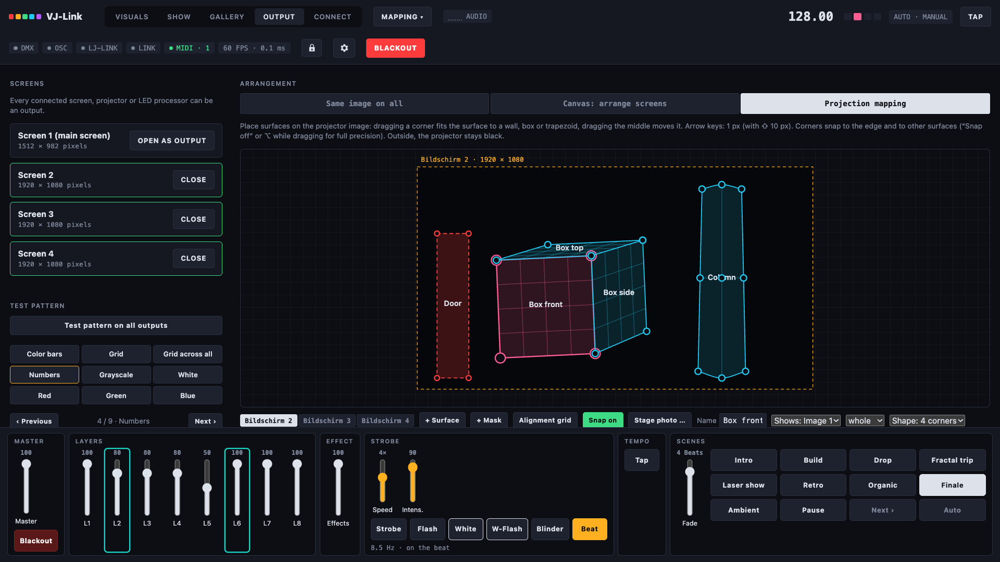

  

<h1 align="center">VJ-Link</h1>

  Live visuals, run by your lighting desk. 
  150 visuals, 50 effects, scenes and outputs, in time with the music.

  <a href="https://skyplayser.github.io/VJ-LINK/">Website</a> &nbsp;·&nbsp;
  <a href="https://github.com/skyplayser/VJ-LINK/releases/latest">Download</a> &nbsp;·&nbsp;
  <a href="#quick-start">Quick start</a> &nbsp;·&nbsp;
  <a href="README.de.md">Deutsch</a> &nbsp;·&nbsp;
  <a href="https://skyplayser.github.io/VJ-LINK/wiki.html">Wiki</a> &nbsp;·&nbsp;
  <a href="https://discord.gg/N6DMca4Bjk">Discord</a> &nbsp;·&nbsp;
  <a href="https://github.com/skyplayser/VJ-LInk-dev">Source code</a>

  
  
  

At most events nobody has time for a second computer full of VJ software. VJ-Link is built for the lighting jockey: the light
desk sends the scene, the colors, the brightness, the strobe and the blackout, and the visuals follow the tempo of the music on
their own. It plays on any number of screens, projectors and LED walls, maps onto walls and boxes, and runs as a timed show with
videos and cues.

It runs locally. There is no account, no cloud and no telemetry. The only connections outside your network are the update check
(GitHub) and a problem report, when you send one.

> [!WARNING]
> **This is the beta 0.1.1.** After a full test day (bugs, workflows, interface and a security test) it is a lot more robust
> than the first alpha, but large parts have still not met real stage hardware. Please try it before an important show, and
> tell us what you find: **Help → Report a problem** in the program.

## What you get

- **150 visuals in 15 categories:** minimal and monochrome, 3D and space, fractals, demoscene, sacred geometry, data and glitch,
  op art, organic and fluid, audio and equalizer, particles, retro and synthwave, geometry and tunnels, light and space, and 16
  laser looks for a projector in haze. All written for VJ-Link, all react to the beat or the audio.
- **50 effects** in a stack of up to six per layer: feedback, datamosh, slit-scan, VHS, bloom, kaleidoscope, halftone, LCD,
  pixel sort, luma key, color strobe, beat flip and many more.
- **Up to eight layers** with blend modes, opacity, position, size and rotation. Each layer chooses its drive: audio when there is
  some, otherwise the beat; only the beat; only the audio; or static.
- **Colors from the desk:** five color slots (A–E) set by DMX, MIDI or OSC. A layer takes one slot, several, a gradient or a
  rainbow.
- **Scenes** with their own transition (cut, beats or seconds, fade or through black) and an automatic order: next after bars,
  seconds or a phrase change from [LJ-Link](https://github.com/skyplayser/LJ-Link).
- **The light desk leads:** Art-Net and sACN with a fixed desk profile (channel list as CSV), plus free mapping for keyboard,
  MIDI, DMX and OSC like in Daslight: click an element, move the fader. Templates for Akai APC mini and Korg nanoKONTROL2, LED
  feedback, modulation with LFOs or audio bands.
- **Tempo from everywhere:** LJ-Link (found automatically, also on other computers), Ableton Link (through Carabiner), OSC,
  MIDI clock or tap.
- **Outputs:** one window per screen in any resolution, the same picture on all of them or one canvas across all, a window output
  for OBS, NDI and Syphon tools, test patterns, and **projection mapping** with corner pin, grid warp (3×3, 5×5) and masks.
- **SHOW:** a running order of video, image, camera, black, scene and timecode cues with GO on the space bar, and a timeline
  where scenes and effects (strobe, flash, blinder, blackout) are laid out like in an editing program. Timecode in and out over
  Art-Net and MIDI.
- **Cameras:** webcam, capture card or OBS Virtual Camera as a clip. Looks: silhouette, outline, dot matrix, ASCII, halftone,
  thermal, duotone and masks that show the visuals only inside the person or cut the person out. **Person detection** runs
  locally (MediaPipe), no green screen needed.
- **Media and text:** logos and images with automatic background removal, videos with a loop locked to the beat, and text clips
  with font, glow, outline and box.
- **From LJ-Link:** tempo, beat phase, phrases and track changes, a *Now Playing* lower third and the DJ waveform as clips.
- **Easy to start:** a start screen, a **demo show** that plays by itself, a gallery to browse and preview every visual and
  effect, a lock mode for the show, project files (`.vjlink`) with their media, updates from GitHub, and **English and German**.

<table>
  <tr>
    <td width="50%"> <b>SHOW.</b> Running order with GO and a timeline for scenes and effects.</td>
    <td width="50%"> <b>Gallery.</b> Browse 150 visuals and 50 effects with a live preview.</td>
  </tr>
  <tr>
    <td> <b>Mapping.</b> Click an element, move a fader on the controller.</td>
    <td> <b>Scene “Drop”</b> from the demo: tunnel, triangles, lasers and a strobe grid.</td>
  </tr>
  <tr>
    <td> <b>Outputs.</b> Screens, canvas, projection mapping and test patterns.</td>
    <td> <b>Report a problem</b> with diagnostic data you can check before sending.</td>
  </tr>
</table>

## Several screens and projection mapping – child's play

No pixel maths and no config files. Under **OUTPUT** you open each projector or LED wall with one click, choose **Canvas** and
drag the screens to where they hang: visuals and videos run seamlessly across all of them. For **projection mapping** you lay
canvases onto the projector picture and drag their corners onto the edges of a wall, a box or a column – live on the projector.
Round surfaces bend with a 3×3 or 5×5 grid, masks black out doors and people.

<table>
  <tr>
    <td width="50%"> <b>Canvas.</b> Drag the screens into place, the edges snap.</td>
    <td width="50%"> <b>Projection mapping.</b> A box, a column with grid warp and a door mask.</td>
  </tr>
</table>

## Install

Download the installer for your computer from the [latest release](https://github.com/skyplayser/VJ-LINK/releases/latest).

| System | File |
|---|---|
| macOS, Apple Silicon (M1 and newer) | `VJ-Link-macos-arm64.dmg` |
| macOS, Intel | `VJ-Link-macos-intel.dmg` |
| Windows 10 / 11, 64 bit | `VJ-Link-windows.exe` |

The installers are not signed yet, so both systems warn once on the first start:

- **macOS** (“VJ-Link” Not Opened): drag the app to *Applications* and start it once, click *Done*. Open *System Settings →
  Privacy & Security*, scroll down, click **Open Anyway** next to VJ-Link and confirm with your password, then *Open*. Allow the
  camera, the microphone and the local network when asked and you need them. Terminal alternative:
  `xattr -dr com.apple.quarantine "/Applications/VJ-Link.app"`.
- **Windows** (“Windows protected your PC”): click **More info**, then **Run anyway**. When the firewall asks, tick *Private
  networks* and allow access, otherwise Art-Net, sACN, OSC and LJ-Link cannot reach VJ-Link.

VJ-Link needs a graphics card with WebGL 2, which almost every computer from the last ten years has.

## Quick start

1. Start VJ-Link and click **Open demo** on the start screen. The ten scenes play by themselves.
2. Open **OUTPUT**, pick the projector or LED wall and open it as an output.
3. Under **CONNECT** check that your desk arrives: set the Art-Net or sACN universe and the start address. Save the channel list
   as CSV and patch VJ-Link like a fixture.
4. Or click **MAPPING → MIDI**, click a fader on the screen and move one on your controller.
5. Running LJ-Link on the same network? VJ-Link finds it by itself and follows the DJ’s tempo.

The program starts in the language of your system; the start screen switches between English and German. The
[wiki](https://skyplayser.github.io/VJ-LINK/wiki.html) walks through every screen.

## Light desk

VJ-Link takes Art-Net or sACN on one universe. The fixed profile *Standard* has 91 channels: master, strobe, scene, transition,
tempo factor, effect intensity, auto and blackout; the five color slots with dimmer and RGB; for layers 1–4 opacity, clip bank
(always 1 for now), clip (visual 1–150 from the catalog), color source, speed, three effects, strobe and blend mode; strobe intensity and mode; and on channels 71–91 the pictures of
the projection mapping. Everything else (layers 5–8, every other control) can be mapped freely. Only channels that change take
effect, so the mouse, MIDI and the desk can work side by side. Your own logos, videos and text clips go on a layer through
free DMX mapping (MAPPING → DMX).

| Desk | How | State |
|---|---|---|
| grandMA2, grandMA3, onPC | Art-Net or sACN, patch the CSV channel list as a fixture | built, not yet tried on a real desk |
| Daslight, other DMX software | Art-Net or sACN | built, not yet tried |
| Any desk or controller with MIDI | MIDI mapping (notes and CCs) | tested in the app |
| Any program with OSC | port 8000, `/vjlink/…`, every control as `/vjlink/ctl/<id>` | tested in the app |
| Timecode | Art-Net and MIDI timecode, in and out, 24/25/29.97 DF/30 fps | built, not yet tried with a desk |

## Compatibility

| Part | State |
|---|---|
| macOS, Apple Silicon | tested |
| macOS, Intel | built, not tested |
| Windows 10 / 11 | built, not tested |
| [LJ-Link](https://github.com/skyplayser/LJ-Link) 1.7.7 | tested: found automatically, tempo, Now Playing |
| Akai LPD8 mk2 | recognized as MIDI input |
| Akai APC mini mk2, APC mini, Korg nanoKONTROL2 | templates from the manuals, not tested on the devices |
| Webcam (UVC), OBS Virtual Camera | tested, person detection tested with one person |
| Ableton Link | through [Carabiner](https://github.com/Deep-Symmetry/carabiner) on port 17000, not yet tried |
| Projector in haze (laser looks) | not yet tried |

Please tell us what you tested: **Help → Report a problem**, or on [Discord](https://discord.gg/N6DMca4Bjk).

## Roadmap

| Target | State |
|---|---|
| Visuals, effects, layers, scenes, SHOW, timeline | done (beta) |
| Art-Net, sACN, MIDI, OSC, keyboard mapping | done, needs tests on real desks |
| Projection mapping, canvas, window output | done (beta) |
| Person detection for camera looks | done (beta) |
| Native Syphon and Spout, NDI | planned (until then: window output and screen capture) |
| Desk profiles as GDTF and grandMA2 XML | planned |
| Remote control in the browser | planned |
| Tempo detection from audio | planned |
| Signed installers | planned |

## Good to know

- **Ableton Link** needs Carabiner as a separate program (the Link SDK is GPL, so VJ-Link does not contain it).
- **Videos:** MP4 with H.264 and WebM play everywhere. Videos are copied into VJ-Link’s library and saved next to the project file
  in a folder “*name* Medien”.
- **Camera looks** with person detection work best with one or a few people in the picture. Small people far away on a big stage
  are found less reliably.
- **Projection mapping** needs one output per projector. A window output can stand in for one, for example to capture it in OBS.
- **Updates** need the internet. Without it everything works as before, the check just says it could not reach GitHub.

## Problems?

Use **Report a problem** in the program (Help menu, settings or the start screen): describe what happens and leave *Include
diagnostic data* ticked. The diagnostic data holds the version, system, graphics card, connected devices, the state of the
connections and the last error messages – no file names, no texts, no titles, no passwords – and you see it before sending. Send
it by email (your mail program opens a mail to fehlermelden@nextphilm.de) or as a GitHub issue.

## Try also: LJ-Link

**[LJ-Link](https://github.com/skyplayser/LJ-Link)** shows the lighting jockey what the DJ plays: every deck, waveform, cue and
the BPM from Pioneer and Denon gear, and sends the tempo to grandMA, Daslight and more. Together with VJ-Link the visuals follow
the DJ’s beat, change scene on the phrase and show what is playing. Free for macOS and Windows.

 

## Credits and notices

Person detection uses [MediaPipe](https://github.com/google-ai-edge/mediapipe) (Apache-2.0). Built with Electron. Ableton Link
works through [Carabiner](https://github.com/Deep-Symmetry/carabiner) by Deep Symmetry, which runs as its own program.

VJ-Link is not an official product of MA Lighting, Daslight, Akai, Korg, Ableton, OBS or Google. All product names belong to
their owners and are used only to describe compatibility.

## License

© 2026 Philipp Spruck / NEXTPHILM. VJ-Link is distributed under the [Eclipse Public License 2.0](LICENSE), without any
warranty. The source code is at [skyplayser/VJ-LInk-dev](https://github.com/skyplayser/VJ-LInk-dev); this repository holds the releases, the website and the
documentation. The licenses of the bundled libraries are in [THIRD_PARTY.md](https://github.com/skyplayser/VJ-LInk-dev/blob/grundgeruest/THIRD_PARTY.md).

 

  Idea SKYPLAYSER/NEXTPHILM 
  Prompted with ❤️ made by Claude

