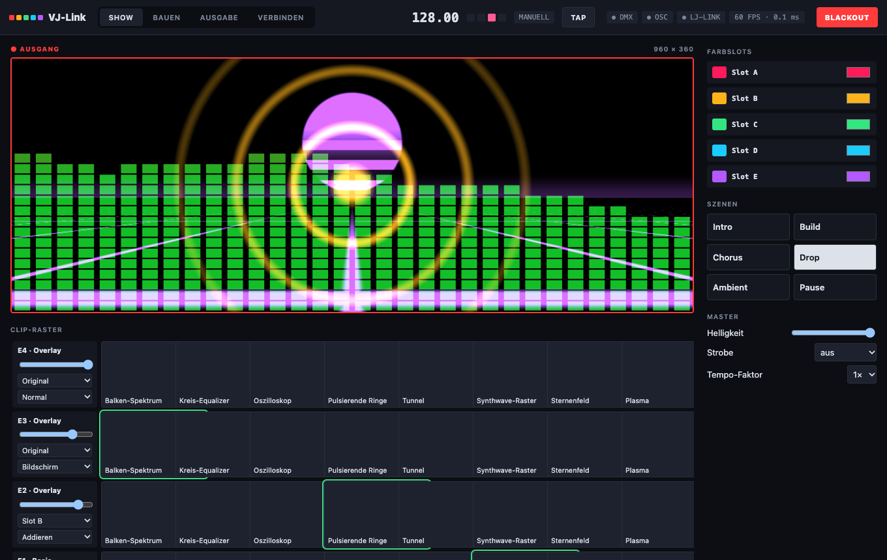
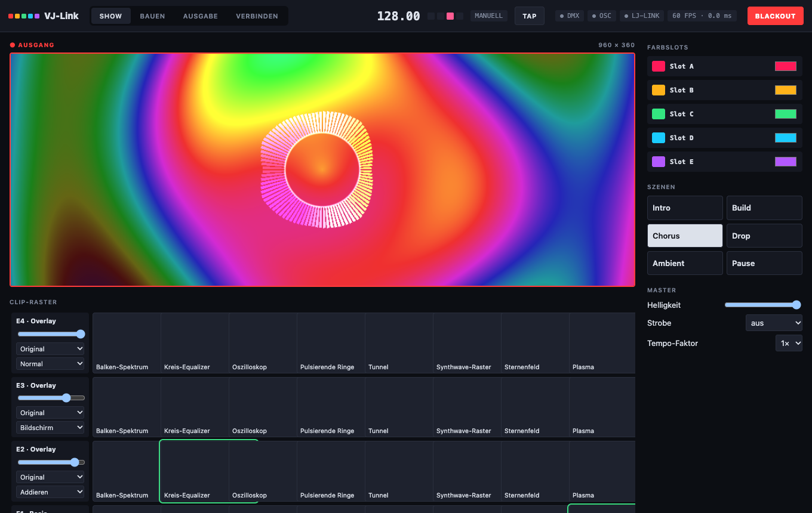
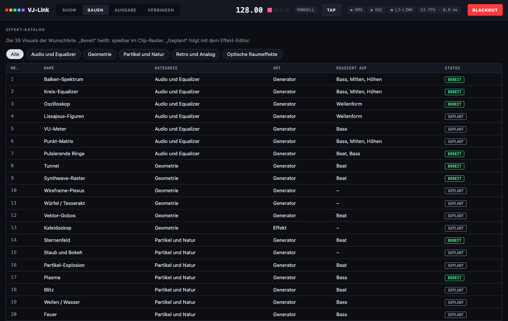
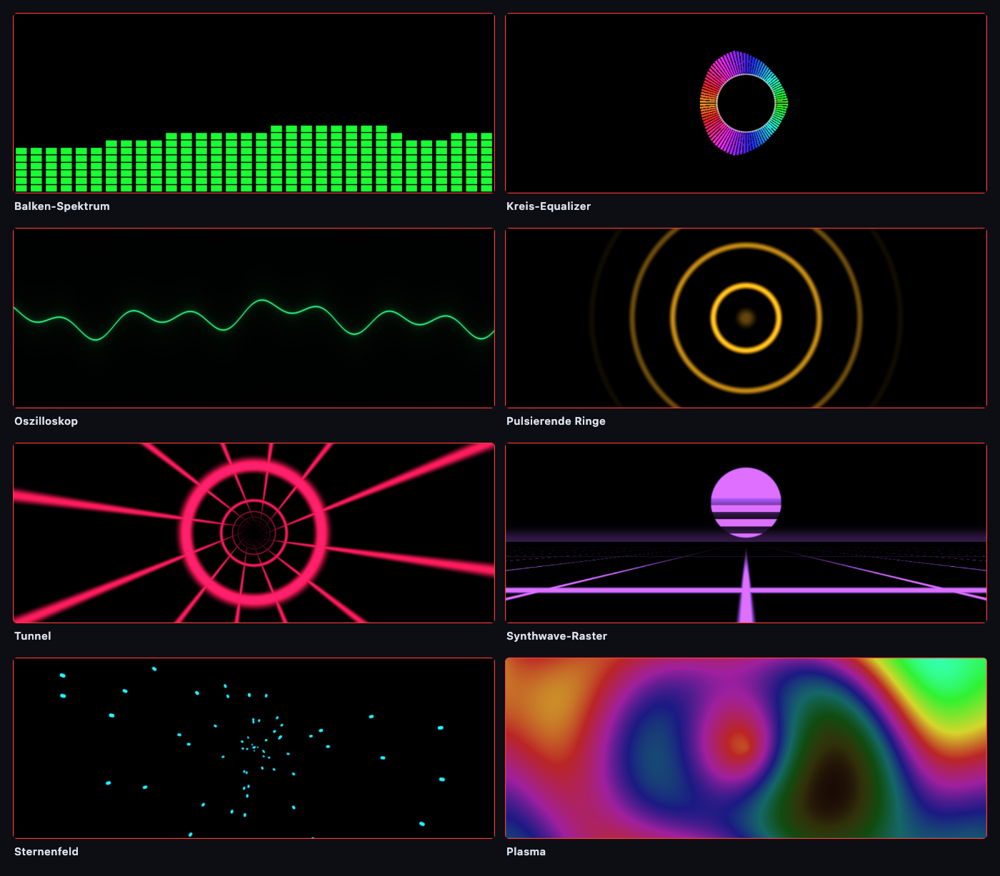
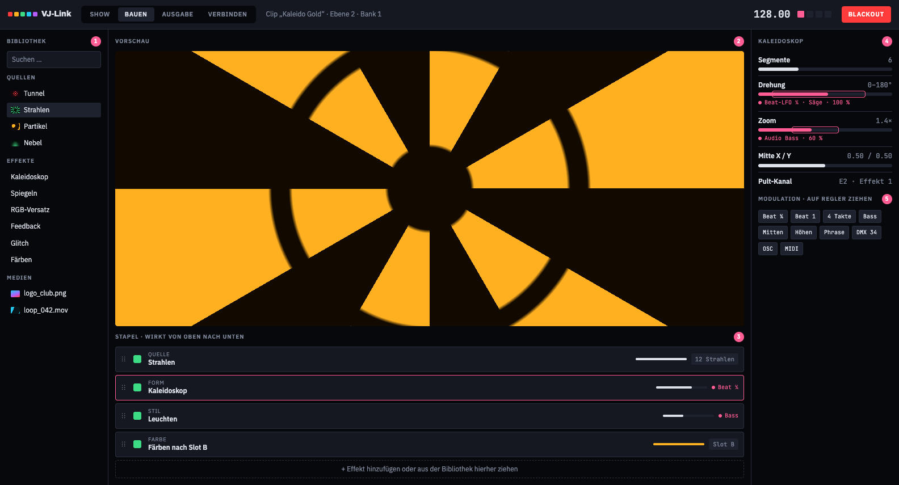
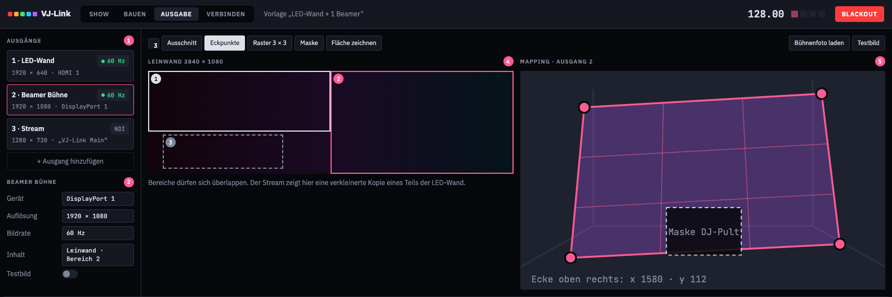
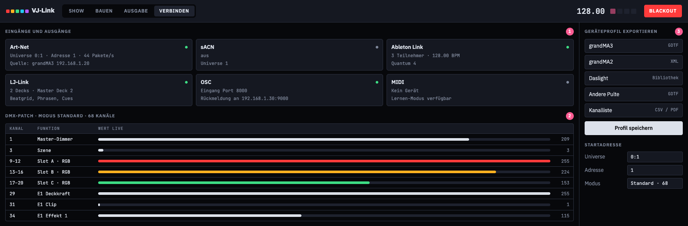
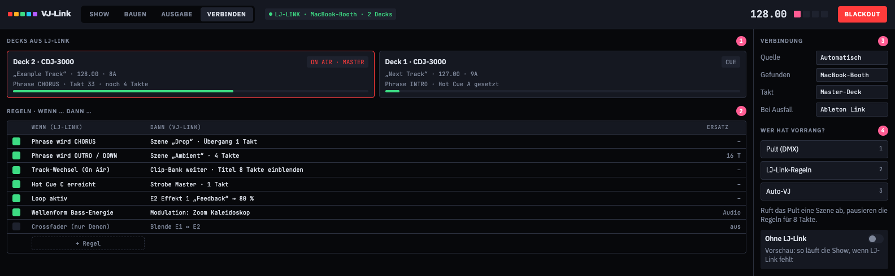
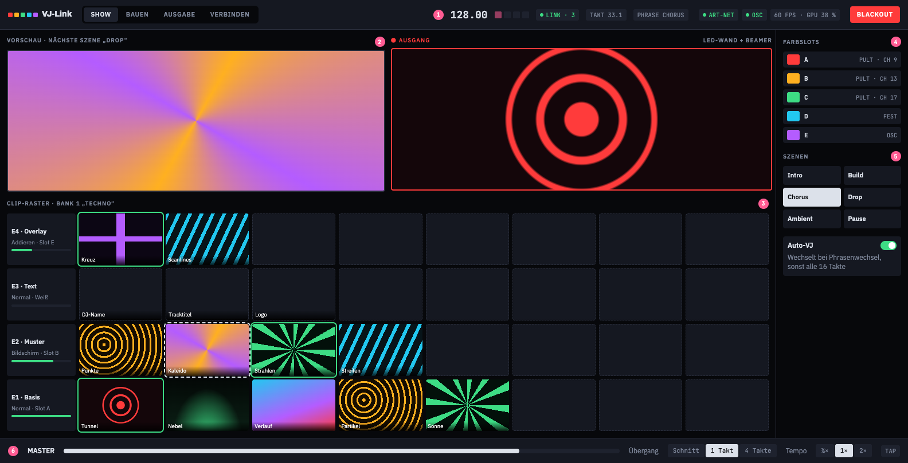

<h1 align="center">VJ-Link</h1>

<b>Visuals, die das Lichtpult steuert.</b> Einfache VJ-Software für LJs. Pult, OSC und LJ-Link geben Takt und Farben vor.

  
  

> **VJ-Link ist noch nicht veröffentlicht.** Hier gibt es noch keinen Download und keinen Quellcode. Diese Seite zeigt, woran gerade gearbeitet wird. Die Programmoberfläche oben ist ein Screenshot vom aktuellen Entwicklungsstand.

VJ-Link ist das Schwesterprojekt von [LJ-Link](https://github.com/skyplayser/LJ-Link). LJ-Link zeigt dem Lichtjockey, was die DJs spielen. VJ-Link nutzt dieselben Daten, damit die Visuals im Takt der Musik laufen und der Lichttechniker sie vom Pult aus steuern kann, ohne einen zweiten Rechner zu bedienen.

## Warum noch ein VJ-Programm?

Die großen VJ-Programme können sehr viel, brauchen aber Einarbeitung. Einfache Programme sind schnell gelernt, lassen sich aber nicht ins Lichtpult einbinden. VJ-Link soll beides verbinden:

1. **Einfach.** Vier Ansichten, keine versteckten Menüs. In fünf Minuten steht das erste Bild.
2. **Das Pult führt.** Szenen, Farben, Helligkeit, Strobe und Blackout kommen per DMX oder OSC.
3. **Alles im Takt.** Der Takt kommt aus LJ-Link, per OSC oder von Hand per Tap.

## So sieht der aktuelle Stand aus

Screenshots aus der laufenden Entwicklungsversion.

| | |
|---|---|
|  |  |
| Show-Ansicht mit vier Ebenen, Farbslots und Szenen | Katalog mit 35 geplanten Visuals |

### Generatoren, die schon laufen

## So könnte es einmal aussehen

Die folgenden Bilder sind **Entwürfe**. Sie zeigen die Richtung, nicht den fertigen Stand. Einzelne Dinge werden sich noch ändern.

### Effekte bauen ohne Programmieren

Effekte liegen als einfacher Stapel übereinander. Jeder Regler lässt sich per Ziehen mit dem Beat, dem Bass oder einem Pult-Kanal bewegen.

### Mehrere Ausgänge und einfaches Mapping

Jeder Bildschirm, Beamer oder LED-Prozessor wird ein Ausgang, in beliebiger Auflösung. Das Mapping geht in drei Stufen: Ausschnitt, Eckpunkte, Raster mit Masken.

### Das Lichtpult steuert wie ein Gerät

Fünf Farbslots (A–E) erscheinen im Pult als kleine RGB-Geräte. Ändert der LJ am Pult die Farbe, färben sich die Visuals mit. Szenen, Ebenen, Effekte und Blackout liegen auf DMX-Kanälen. Das passende Geräteprofil soll VJ-Link selbst erzeugen.

### Direkt mit LJ-Link verbunden

Läuft LJ-Link, bekommt VJ-Link alles, was die Decks wissen: Tempo, Phrasen (Intro, Chorus, Outro), Cues, Loops und Track-Wechsel. Daraus entstehen einfache Regeln, etwa „Wenn der Chorus beginnt, dann Szene Drop“. VJ-Link läuft auch ohne LJ-Link vollständig, dann springen die Regeln auf Ersatzwerte um.

### Die Show-Ansicht

## Funktionen

**Schon im Entwicklungsstand vorhanden**

- Vier Ebenen mit Deckkraft, Mischmodus und Farbquelle
- Acht Generatoren, Master-Helligkeit, Strobe, Blackout
- Takt aus LJ-Link, OSC oder Tap, mit sauberem Rückfall, wenn eine Quelle ausfällt
- DMX-Eingang über Art-Net und sACN, OSC-Eingang
- Ein Vollbild-Ausgang pro angeschlossenem Bildschirm, mit Testbild
- Eingang von LJ-Link mit Regeln „Wenn … dann …“, Privatsphäre-Modus wird beachtet

**Geplant**

- Effekt-Editor mit Modulation per Ziehen
- Freie Auflösung pro Ausgang und einfaches Mapping
- Videos und Bilder als Clips, Text für DJ-Namen und Tracktitel
- Szenen mit Überblendung im Takt, Auto-VJ
- Geräteprofile für Lichtpulte, Fernbedienung per Tablet im Browser
- MIDI, Audio-Eingang, Ableton Link
- Weitere Visuals: Kaleidoskop, Feedback, Glitch, Feuer, Blitz, Laser-Fächer, Spiegelkugel und viele mehr (insgesamt 35)

## Für welche Pulte?

Gedacht ist alles, was Art-Net oder sACN ausgibt, darunter grandMA2/3, Daslight, ChamSys, Avolites, Onyx und QLC+. Wie gut das mit den einzelnen Pulten und Versionen klappt, wird erst im Test geklärt. Bisher gibt es keine Aussage, dass ein bestimmtes Pult freigegeben ist.

## Wann kommt es?

Einen Termin gibt es nicht. Sobald es eine erste Version zum Ausprobieren gibt, steht sie hier unter **Releases**. Wer informiert werden möchte, klickt oben rechts auf **Watch → Custom → Releases**.

## Plattformen

Geplant sind macOS und Windows, wie bei LJ-Link.

## Hinweise

- Lizenz und Preis stehen noch nicht fest.
- Alle genannten Produkt- und Firmennamen (z. B. grandMA, Daslight, Pioneer DJ, rekordbox) gehören ihren Inhabern. VJ-Link ist ein unabhängiges Projekt und steht in keiner Verbindung zu diesen Firmen.

---

**English:** VJ-Link is an upcoming, simple VJ / visuals app for lighting jockeys, controlled by the lighting desk (DMX over Art-Net or sACN, OSC) and fed directly by [LJ-Link](https://github.com/skyplayser/LJ-Link). Work in progress, no release yet. Images marked as "Entwurf" are design sketches, not the finished product.
